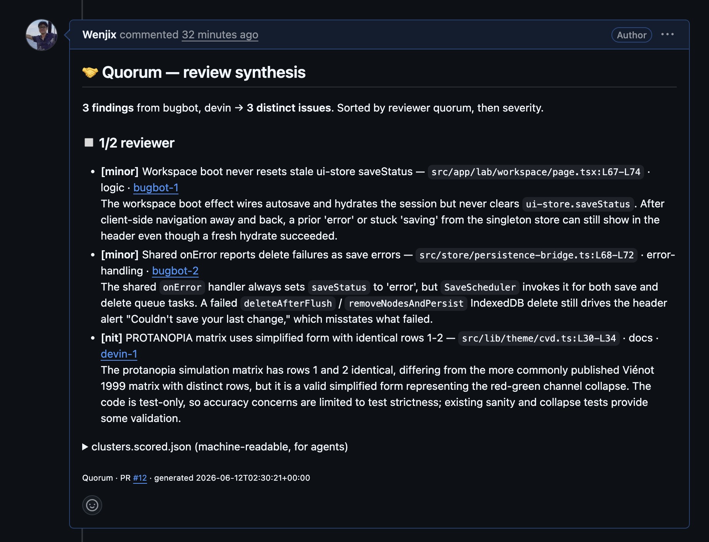
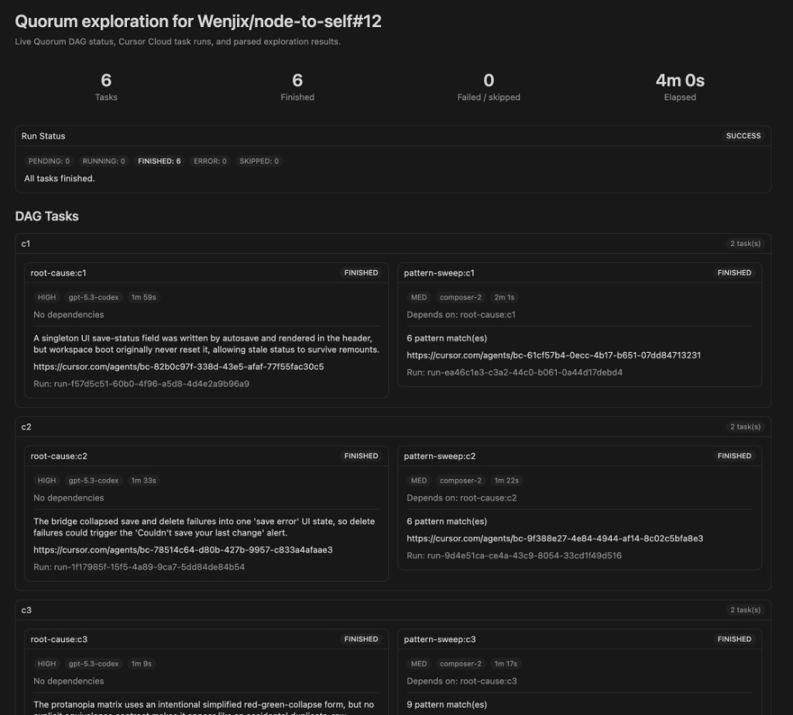

# Quorum

Quorum turns noisy automated PR reviews into one prioritized, explainable review brief.

Modern teams often run several AI reviewers on the same pull request: Cursor Bugbot, GitHub Copilot, Devin Reviewer, CodeRabbit, and others. Each reviewer may catch useful issues, but the result is hard to scan, hard to compare, and hard for follow-up agents to use.

Quorum adds a consensus layer. It groups duplicate findings, highlights where multiple reviewers agree, and can launch cloud agents — Cursor Cloud by default, or Anthropic — to explain root causes and search for similar bug patterns elsewhere in the repository.

## Why It Matters

For reviewers and engineering leads:

- See the issues that multiple reviewers independently found.
- Spend less time reading duplicate comments.
- Understand whether a finding is an isolated bug or a repeated pattern.

For agents and automation:

- Convert review prose into structured JSON.
- Preserve links back to the original review comments.
- Feed downstream agents a clean list of distinct issues instead of raw bot output.

For product teams:

- Make AI review output easier to trust, measure, and improve.
- Build a dataset of which findings were fixed, ignored, or false positives.
- Compare reviewer precision over time by category and quorum level.

## What Quorum Does

Quorum currently has two layers.

1. **Review synthesis skill (the triage director)**
   - Fetches line-anchored review comments from bot accounts on a GitHub PR.
   - Clusters comments that describe the same underlying issue.
   - Computes reviewer quorum deterministically and derives each cluster's lane from it: `agreed` when two or more distinct reviewers raised the issue, `solo` otherwise.
   - Drives the triage with read-only subagents. An `agreed` cluster is presumed real, so it is escalated to a missing invariant, a sibling sweep and a fix brief instead of being re-proved. A `solo` cluster is proved or killed with evidence.
   - Keeps one PR comment in sync: a human brief on top (a merge gate line instead of a confidence score, then the two lanes) and an agent layer collapsed below it (the triage protocol plus the `quorum/triage@1` JSON). The comment is upserted in place as the PR moves through the plan, validated and fixed states.

2. **Cloud exploration runner**
   - Reads the scored Quorum clusters.
   - Selects the `agreed` lane by default (`quorum >= 2`).
   - Runs a small DAG of agents for each selected cluster, on a pluggable backend: Cursor Cloud (default) or Anthropic.
   - Produces root-cause analysis, pattern-sweep results, local artifacts, and an optional PR comment.
   - Renders a live-updating Cursor Canvas of the DAG while agents run.

The cloud runner is explore-only today. It does not create commits, push branches, or open fix PRs.

## Example Output

Quorum posts one comment that groups automated-review findings into distinct issues, shows reviewer quorum and the merge gate, preserves links back to the original bot comments, and embeds machine-readable JSON for follow-up agents. The screenshot predates the triage brief and shows the earlier synthesis layout.



## How It Works

```text
Bot review comments
        |
        v
Quorum skill
  fetch -> cluster -> validate and score -> post plan -> triage lanes -> record dispositions
        |
        v
clusters.scored.json  (quorum/triage@1, also embedded in the PR comment)
        |
        v
Cloud exploration DAG (agreed lane by default)
  root cause -> pattern sweep -> report
        |
        v
exploration.md + exploration.json + Canvas + optional PR comment
```

## Quick Start

### Requirements

- Node.js 22 or newer
- `npm`
- `gh` CLI, authenticated for the target GitHub repo
- `jq` and `python3` (3.9 or newer) for the skill scripts
- An exploration backend key for live runs: `CURSOR_API_KEY` (default Cursor Cloud backend) or `ANTHROPIC_API_KEY` (with `--provider anthropic`). An authenticated `gh` or `GITHUB_TOKEN` also lets the Anthropic backend fetch the PR diff for code context; it degrades gracefully without one.

Install dependencies and build:

```bash
npm install
npm run build
```

For the shortest local commands, link the CLI once:

```bash
npm link
```

After that, use `quorum ...` from any directory. Without `npm link`, replace `quorum` with `node dist/src/cli.js` from this repo.

Run tests:

```bash
npm test
```

## Use the Quorum Skill

The packaged skill is `quorum.skill`. It can be installed into Claude Code or Cursor.

For Claude Code:

```bash
mkdir -p .claude/skills
unzip quorum.skill -d .claude/skills
```

For Cursor:

```bash
mkdir -p .cursor/skills
unzip quorum.skill -d .cursor/skills
```

Then open an agent session on a PR branch and ask:

```text
Use Quorum to triage the bot reviews on this PR.
```

The skill walks these steps (the full flow is in `SKILL.md`). Script and reference paths are relative to the installed skill directory:

1. **Fetch and count reviewers.** `scripts/fetch_findings.sh OWNER/REPO PR findings.json` normalizes the line-anchored bot comments. If no finding matches, nothing proceeds; if the bot logins are known but missed, set `QUORUM_BOTS`.
2. **Single-reviewer fast path.** With one distinct reviewer there is nothing to cluster: skip the clustering step and score with `python3 scripts/validate_partition.py findings.json --all-singletons`. Every cluster lands in the `solo` lane.
3. **Cluster.** The agent reads `references/clustering-rubric.md` and writes `clusters.json`. It matches findings and never re-reviews them.
4. **Validate and score.** `python3 scripts/validate_partition.py findings.json clusters.json -o clusters.scored.json [--priors PATH]` checks the partition, computes quorum and the lane in code, and writes the `quorum/triage@1` document. After two failed attempts it falls back to `--all-singletons`.
5. **Post the plan.** `python3 scripts/quorum_ledger.py post-plan OWNER/REPO PR clusters.scored.json` (preview with `--dry-run`) upserts the one PR comment. Tell the skill `--no-comment` (a choice in the skill, not a script flag) to skip this step entirely, typical on a single-reviewer PR. Without a ledger there is nothing for `escalate` and `dispose` to write, so results are reported in conversation instead.
6. **Drive the triage.** One escalation subagent per `agreed` cluster (prompted with `references/escalation-prompt.md`) and one validator subagent per batch of up to four `solo` clusters (`references/validator-prompt.md`), all read-only and in parallel.
7. **Record dispositions.** `python3 scripts/quorum_ledger.py escalate OWNER/REPO PR CLUSTER_ID --from escalation.json` for an agreed cluster, `python3 scripts/quorum_ledger.py dispose OWNER/REPO PR --from dispositions.json --reply` for solo verdicts. A refusal names the offending field and writes nothing.
8. **Fix, then record the commit.** Fixes are the owner's call. After each one: `python3 scripts/quorum_ledger.py dispose OWNER/REPO PR CLUSTER_ID --commit SHA --tests "what ran" --reply`. A declined fix is recorded as `--verdict deferred --note "<their reason>" --by owner`, which stops that cluster holding the merge gate.

`scripts/quorum_ledger.py` is the only script that writes the PR comment, and every write re-renders the whole comment from its embedded JSON. The Phase 2 runner recovers that JSON from the PR automatically, so you usually do not need to pass a local `--scored` path.

You can also run Phase 1 directly from the CLI without the skill:

```bash
quorum synthesize OWNER/REPO#123
```

This fetches findings, scores clusters deterministically (all-singletons unless a `clusters.json` is supplied), and posts the plan through `quorum_ledger.py`. Add `--dry-run` to preview the comment or `--no-post` to skip posting.

To give the skill each reviewer's past precision in a repo, compute priors from the repo's earlier ledgers:

```bash
quorum priors OWNER/REPO [--out PATH]
```

The default path is `.quorum/priors/<owner>-<repo>.json`. `post-plan` embeds a priors file younger than a week as `priors`, and a reviewer needs at least five judged findings to get one. A prior says how often a reviewer has been right here; it is never a verdict on the finding in front of you.

## Use the Cloud Runner

First set the API key for your backend (Cursor Cloud is the default):

```bash
export CURSOR_API_KEY="crsr_..."        # default backend
# or, for the Anthropic backend:
export ANTHROPIC_API_KEY="sk-ant-..."
```

Generate the exploration DAG, report shell, and Canvas without making any cloud or GitHub calls:

```bash
quorum plan-pr https://github.com/OWNER/REPO/pull/123
```

Run live exploration but do not post to GitHub:

```bash
quorum run-pr https://github.com/OWNER/REPO/pull/123
```

Run live exploration and upsert the PR exploration comment:

```bash
quorum post-pr https://github.com/OWNER/REPO/pull/123
```

Synthesize and explore in one shot (Phase 1 then Phase 2):

```bash
quorum triage-pr https://github.com/OWNER/REPO/pull/123
```

`run-pr`, `post-pr` and `triage-pr` select the `agreed` lane by default. Pass `--min-quorum 1` to take the solo lane too, or `--cluster ID[,ID]` to pick clusters by id. `post-pr` still writes its own `<!-- quorum:exploration -->` comment, separate from the triage comment, until a runner follow-up records the exploration results in the ledger.

### Choosing a provider

Exploration runs on a pluggable backend. Cursor Cloud is the default; Anthropic is an alternative.

```bash
--provider cursor|anthropic   Backend to use. Default: cursor (or $QUORUM_PROVIDER).
--api-key KEY                 Override the backend API key for this run.
```

Set the default with the `QUORUM_PROVIDER` environment variable. Each backend has per-complexity default models, overridable with `QUORUM_MODEL_HIGH`, `QUORUM_MODEL_MED`, and `QUORUM_MODEL_LOW` (env vars win over a saved `dag.json`, which wins over these defaults):

| Complexity | Cursor (default) | Anthropic           |
| ---------- | ---------------- | ------------------- |
| HIGH       | `gpt-5.3-codex`  | `claude-opus-4-8`   |
| MED        | `composer-2.5`   | `claude-sonnet-4-6` |
| LOW        | `composer-2.5`   | `claude-haiku-4-5`  |

The Anthropic backend is **code-aware**: it fetches the pull request's unified diff and injects it as the agent's view of the code (capped at 200k characters, read-only — it never edits, commits, or pushes). When the diff cannot be fetched it falls back to a "no code context" note and flags missing evidence rather than guessing, so authenticate `gh` or set `GITHUB_TOKEN` for best results.

Open or regenerate a Canvas from an existing run:

```bash
quorum canvas .quorum/runs/<run-id>
```

Advanced/debug mode is still available:

```bash
quorum explore \
  --repo OWNER/REPO \
  --pr 123 \
  --scored path/to/clusters.scored.json \
  --no-post
```

Useful options:

```bash
--provider NAME          Backend: cursor (default) or anthropic.
--api-key KEY            Override the backend API key.
--cluster ID[,ID]        Explore specific cluster IDs.
--min-quorum N           Quorum floor; default selects the agreed lane (quorum >= 2).
--max-clusters N         Limit selected clusters.
--scored PATH            Use a local clusters.scored.json instead of PR recovery.
--out DIR                Write artifacts to a custom directory.
--concurrency N          Default: 4.
--task-timeout-ms N      Default: 1200000.
--dry-run | --no-post    Do not write a PR comment.
--post                   For run-pr only: post the exploration comment after running.
--plan-only              Do not call the cloud backend or GitHub.
--no-stream              Wait for final agent results only (Cursor backend).
--canvas-path PATH       Write the Cursor Canvas artifact to this path.
--no-canvas              Skip Canvas generation.
--no-canvas-mirror       Skip mirroring the Canvas into Cursor's managed canvases directory.
```

### Utility commands

```bash
quorum synthesize OWNER/REPO#PR   Run the Phase 1 pipeline (fetch, score, post plan); all-singletons when no clusters.json is given.
quorum priors OWNER/REPO [--out PATH]   Compute per-reviewer precision priors from past ledgers in a repo.
quorum setup                 Check prerequisites, backend keys, and skill install.
quorum eval [--log-dir DIR]  Summarize past run logs (task outcomes, durations).
quorum run-dag --dag dag.json --out DIR --repo OWNER/REPO   Run a saved DAG directly.
```

## Outputs

### The triage comment

The skill keeps one PR comment, found by its hidden `<!-- quorum:synthesis -->` marker and updated in place on every write. It has two layers:

- **Human brief.** The merge gate line, a counts line, the `agreed` lane (presumed real, escalated), the `solo` lane (prove or kill), and any clusters the owner deferred. There is no confidence score; the gate is derived from the recorded dispositions.
- **Agent layer**, collapsed under a `<details>` block. It holds the triage protocol and the `quorum/triage@1` JSON in a fenced `json` block. If the JSON would overflow GitHub's comment limit it is shrunk in steps (member URLs, then siblings, then a minimal document marked `truncated`), and the ledger script rebuilds from a local `--scored` file when it meets a truncated one.

The comment moves through three states, shown in the gate line and the footer timeline (`plan → validated → fixed`):

| State     | Gate line                                    | Meaning                                                                   |
| --------- | -------------------------------------------- | ------------------------------------------------------------------------- |
| Plan      | `⏳ Triage pending`                           | Clusters and lanes are posted; no disposition recorded yet.               |
| Validated | `🛑 Blocked by N issue(s)`                    | Triage has started; critical or major clusters with a `valid` or `partly` verdict and no fixing commit hold the gate, as do those still unreviewed. |
| Fixed     | `✅ Merge gate clear`                         | Nothing holds the gate; the line names what it was blocked by, the fixing commits and the tests. |

The `quorum/triage@1` block holds the PR and head SHA, totals and per-reviewer counts, the `lanes` (the `agreed` and `solo` cluster ids), per-reviewer `priors` when a fresh priors file exists, and per cluster: its lane, quorum, P-tag, members with links to the original comments, locations, `mechanism_agreement`, the latest `disposition` (verdict, note, evidence, fixing commit, tests, who and when, or `stale: true` when the head moved under it) and, for an agreed cluster, its `escalation` (invariant, sibling sites, chokepoint, test). The derived `gate`, `deferred` and `timeline` are recomputed on every write.

An agent without the Quorum skill can still triage. The protocol embedded in the comment says what each lane needs and how to report through `quorum_ledger.py`, and the scripts come from the tagged tarball:

```bash
gh api repos/Wenjix/quorum/tarball/v0.3.0 > quorum.tgz && tar -xzf quorum.tgz
```

Both `scripts/` and `references/` are needed together.

### Exploration run artifacts

Each shortcut run writes artifacts under `.quorum/runs/<repo>-pr<N>-<timestamp>/` by default.

- `input.clusters.scored.json`: the scored triage input
- `dag.json`: the exploration graph
- `state.json`: task status, model, run ID, agent ID, errors, and parsed results
- `exploration.json`: structured root-cause and pattern-sweep output
- `exploration.md`: human-readable report
- `quorum-exploration.canvas.tsx`: Cursor Canvas artifact for visual DAG status and task summaries

When posting is enabled, Quorum upserts one PR comment using the hidden marker:

```html
<!-- quorum:exploration -->
```

Reruns update the existing exploration comment instead of spamming the PR.

## Cursor Canvas Integration

Quorum renders each run as a Cursor Canvas: a live React view showing run status, per-cluster task cards, agent links, and parsed results.



Cursor only renders `.canvas.tsx` files as interactive Canvases when they live in the workspace's managed canvases directory:

```text
~/.cursor/projects/<workspace-slug>/canvases/
```

So in addition to the copy in the run's output directory, Quorum automatically mirrors the Canvas there as `quorum-<repo>-pr<N>.canvas.tsx` (for example `quorum-node-to-self-pr12.canvas.tsx`). The CLI prints both paths:

```text
canvas .quorum/runs/<run-id>/quorum-exploration.canvas.tsx
canvas (Cursor) ~/.cursor/projects/<workspace-slug>/canvases/quorum-node-to-self-pr12.canvas.tsx
```

Click the `canvas (Cursor)` path in Cursor to open it beside the chat. The mirror is skipped when the workspace has never been opened in Cursor, or when `--no-canvas-mirror` or `--no-canvas` is passed.

**Live-updating DAG.** Quorum rewrites both Canvas copies on every task state change — task start, finish, error, and skip — so the Canvas updates in place while root-cause and pattern-sweep agents run: status pills flip from `PENDING` to `RUNNING` to `FINISHED`, durations fill in, and result summaries appear as each agent completes.

You can also re-render a Canvas from a saved run without re-running anything:

```bash
quorum canvas .quorum/runs/<run-id>
```

## Safety Defaults

Quorum treats reviewer consensus as signal, not truth.

- Clustering is conservative: when uncertain, keep findings separate.
- Quorum, and the lane derived from it, is computed in code from distinct reviewers, not by the model.
- Only comments from Bot-type accounts are ingested, and only when the login matches the reviewer regex: by default `cursor[bot]|copilot|devin|greptile|coderabbit`. Set `QUORUM_BOTS` to override the regex. A human account is never ingested, whatever its login.
- Ledger comments are trusted only when written by the authenticated `gh` login or by an account with `OWNER`, `MEMBER` or `COLLABORATOR` association, so a forged comment cannot plant dispositions.
- That trust check does not work under a GitHub App or Actions token. `GET /user` is refused for such a token, and a `[bot]` comment with association `NONE` is not recognised, so a CI run would post a new comment each time instead of updating one. Hosted automation is a later round.
- The triage subagents make no tracked-file edits. Fixes are the owner's call, and a fix brief is a proposal until the owner says go.
- Cloud exploration is read-only by prompt and by configuration, on both the Cursor and Anthropic backends.
- The Cursor runner sets `autoCreatePR: false`; the Anthropic backend only ever sees the PR diff and is instructed never to edit, commit, or push. Neither asks agents to change files.
- Pattern sweeps classify likely and possible repeats; they do not apply fixes.

## Repository Layout

```text
SKILL.md                 Skill instructions for the triage director
quorum.skill             Packaged Claude/Cursor skill (scripts and references, without tests)
scripts/                 Skill scripts (Python 3.9+): fetch, validate_partition, quorum_ledger, priors
scripts/tests/           Python test suite (not shipped in quorum.skill or the npm tarball)
references/              Clustering rubric, triage protocol, escalation and validator prompts
src/                     TypeScript cloud runner
test/                    Node test suite
package.json             Build, test, and dependency metadata
```

Key skill scripts:

- `scripts/quorum_ledger.py`: the only writer of the PR comment (`post-plan`, `dispose`, `escalate`, `show`)
- `scripts/validate_partition.py`: partition check, quorum, lanes, and the `quorum/triage@1` document
- `scripts/quorum_priors.py`: per-reviewer precision priors from past ledgers

Key source modules:

- `src/cli.ts`: command-line interface
- `src/dag.ts`: DAG validation, rank computation, and per-provider model defaults
- `src/runner.ts`: task execution and state persistence
- `src/canvas.ts`: Cursor Canvas rendering
- `src/cursor-cloud-adapter.ts`: Cursor Cloud backend
- `src/adapters/anthropic.ts`: Anthropic backend (code-aware via PR diff injection)
- `src/report.ts`: JSON and Markdown exploration reports
- `src/github.ts`: idempotent PR comment upsert and PR diff fetch

## Development

Run type checks:

```bash
npm run typecheck
```

Run the full test suite (builds, then runs the Node tests and the Python suite under `scripts/tests`):

```bash
npm test
```

Build the CLI:

```bash
npm run build
```

After building, the CLI entrypoint is:

```bash
node dist/src/cli.js --help
```

## Current Status

Quorum is built for dogfooding.

It is not yet a hosted GitHub App. The fastest path is still interactive use: run the skill on a PR, work the two lanes, then launch cloud exploration for the agreed findings.

Planned next steps:

- Preserve dogfood logs for reviewer precision analysis.
- Add richer evaluation around bad merges and false positives.
- Add optional fix-draft agents after the explore-only flow is reliable.
- Package hosted automation through GitHub Actions or a GitHub App.
