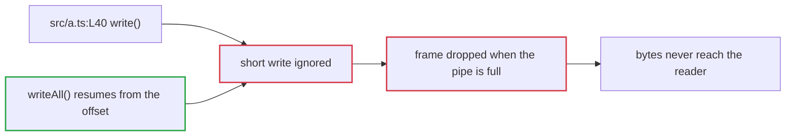

<!-- quorum:synthesis -->
## 🤝 Quorum · triage brief
<sub>head `abc1234` · 3 reviewers · updated 2026-10-29T13:44:00+00:00</sub>

**✅ Merge gate clear** · was blocked by 2 · fixed in ba814e4
**6 findings** from bugbot, devin, greptile → **4 issues** · 2 valid · 1 partly · 0 dismissed · 1 deferred

### Agreed · presumed real, escalated
- **P1** Pipe writer loses data when the pipe is full · `src/a.ts:L40` · 2/3 bugbot, devin · [bugbot-1](https://github.com/o/r/pull/7#discussion_r1001), [devin-1](https://github.com/o/r/pull/7#discussion_r1002)
  ✅ valid · fixed `ba814e4` · both reviewers right
  Invariant: Every write to the pipe must report how many bytes it accepted, and the caller must resume from that offset.

- **P2** Unused import · `src/e.ts:L3` · 2/3 bugbot, greptile · [bugbot-2](https://github.com/o/r/pull/7#discussion_r1005), [greptile-2](https://github.com/o/r/pull/7#discussion_r1006)
  ⚠ partly · fixed `ba814e4` · only the os import was unused

### Solo · prove or kill
- **P1** Retry loop runs one extra attempt · `src/c.ts:L5` · 1/3 devin · [devin-2](https://github.com/o/r/pull/7#discussion_r1003)
  ✅ valid · fixed `ba814e4` · off by one confirmed
- **P2** Variable shadows the import · `src/d.ts:L7-L9` · 1/3 greptile · [greptile-1](https://github.com/o/r/pull/7#discussion_r1004)
  ⏸ deferred · pre-existing, follow-up later

### Deferred by owner · 1
Variable shadows the import

<details><summary>🤖 For triage agents · protocol, plan and ledger</summary>

**Protocol** (for an agent without the Quorum skill)

1. `agreed` clusters: do not re-prove. Establish the missing invariant, sweep for sibling sites, write a fix brief naming the chokepoint and the test. Report with `escalate`.
2. `solo` clusters: prove or kill. Cheapest reproduction first. Return `valid | partly | invalid` with evidence. Report with `dispose`. `priors` in the JSON is each reviewer's past precision here: a prior, never a verdict.
3. If `mechanism_agreement` is `split`, establish the true mechanism before fixing anything.
4. Skip clusters that already carry a disposition unless it is marked `stale: true`.
5. Report with `python3 scripts/quorum_ledger.py dispose OWNER/REPO PR CLUSTER_ID --verdict valid|partly|invalid|deferred --note "..." [--evidence "..."] [--commit SHA] --reply` or `escalate OWNER/REPO PR CLUSTER_ID --from escalation.json`; Quorum re-renders this comment. Run it from a checkout of https://github.com/Wenjix/quorum, or unpack the scripts with `mkdir -p quorum && gh api repos/Wenjix/quorum/tarball/v0.3.0 > quorum.tgz && tar -xzf quorum.tgz -C quorum --strip-components=1` and run `python3 quorum/scripts/quorum_ledger.py ...` (the `scripts/` and `references/` directories are needed together).

```json
{
  "schema": "quorum/triage@1",
  "pr": "o/r#7",
  "head": "abc1234",
  "generated_at": "2026-10-29T12:00:00+00:00",
  "totals": {
    "findings": 6,
    "clusters": 4,
    "reviewer_denominator": 3,
    "gate_split": []
  },
  "reviewers": {
    "bugbot": 2,
    "devin": 2,
    "greptile": 2
  },
  "priors": {},
  "lanes": {
    "agreed": [
      "c1",
      "c4"
    ],
    "solo": [
      "c2",
      "c3"
    ]
  },
  "clusters": [
    {
      "cluster_id": "c1",
      "member_ids": [
        "bugbot-1",
        "devin-1"
      ],
      "canonical_title": "Pipe writer loses data when the pipe is full",
      "canonical_description": "Pipe writer loses data when the pipe is full.",
      "category": "data-integrity",
      "severity": "major",
      "primary_location": {
        "file": "src/a.ts",
        "start_line": 40,
        "end_line": 40
      },
      "match_type": "same-root-cause",
      "match_confidence": 0.9,
      "cross_file": false,
      "match_rationale": "Both describe lost pipe writes fixed by one change to the writer.",
      "symptom": "Bytes written to the pipe never reach the reader.",
      "mechanisms_claimed": [
        {
          "reviewer": "bugbot",
          "member_id": "bugbot-1",
          "mechanism": "The writer ignores a partial write return value."
        },
        {
          "reviewer": "devin",
          "member_id": "devin-1",
          "mechanism": "The writer drops the whole frame when the pipe is full."
        }
      ],
      "mechanism_agreement": "split",
      "quorum": 2,
      "reviewers": [
        "bugbot",
        "devin"
      ],
      "lane": "agreed",
      "p_tag": "P1",
      "validation": {
        "mode": "escalate"
      },
      "locations": [
        {
          "file": "src/a.ts",
          "lines": [
            40,
            40
          ],
          "from": "bugbot-1"
        },
        {
          "file": "src/b.ts",
          "lines": [
            30,
            31
          ],
          "from": "devin-1"
        }
      ],
      "escalation": {
        "verdict": "valid",
        "invariant": "Every write to the pipe must report how many bytes it accepted, and the caller must resume from that offset.",
        "siblings": [
          {
            "file": "src/b.ts",
            "lines": [
              30,
              31
            ],
            "risk": "likely",
            "rationale": "Same frame writer, drops the frame on EAGAIN."
          },
          {
            "file": "src/f.ts",
            "lines": [
              88,
              90
            ],
            "risk": "possible",
            "rationale": "Copies the pattern but flushes before returning."
          },
          {
            "file": "src/g.ts",
            "lines": [
              12,
              12
            ],
            "risk": "unlikely",
            "rationale": "Writes to a regular file, which never returns a short count."
          }
        ],
        "chokepoint": "src/pipe.ts writeAll(): the one function every writer calls, so one fix covers every site.",
        "test": "writeAll resumes after a short write and reports the final byte count.",
        "evidence": [
          {
            "file": "src/a.ts",
            "lines": [
              40,
              40
            ],
            "note": "the return value of write() is ignored"
          }
        ],
        "map": {
          "nodes": [
            {
              "id": "src_a",
              "label": "src/a.ts:L40 write()",
              "kind": "source"
            },
            {
              "id": "short",
              "label": "short write ignored",
              "kind": "break"
            },
            {
              "id": "drop",
              "label": "frame dropped when the pipe is full",
              "kind": "break"
            },
            {
              "id": "lost",
              "label": "bytes never reach the reader",
              "kind": "symptom"
            },
            {
              "id": "writeAll",
              "label": "writeAll() resumes from the offset",
              "kind": "fix"
            }
          ],
          "edges": [
            [
              "src_a",
              "short"
            ],
            [
              "short",
              "drop"
            ],
            [
              "drop",
              "lost"
            ],
            [
              "writeAll",
              "short"
            ]
          ]
        },
        "by": "agent",
        "at": "2026-10-29T13:20:00+00:00"
      },
      "disposition": {
        "verdict": "valid",
        "note": "both reviewers right",
        "evidence": [
          "src/a.ts:40 ignores the return value of write()"
        ],
        "commit": "ba814e4",
        "by": "agent",
        "at": "2026-10-29T13:38:00+00:00"
      },
      "disposition_history": [],
      "members": [
        {
          "id": "bugbot-1",
          "reviewer": "bugbot",
          "file": "src/a.ts",
          "lines": [
            40,
            40
          ],
          "url": "https://github.com/o/r/pull/7#discussion_r1001",
          "comment_id": 1001,
          "node_id": "PRRC_bugbot-1",
          "outdated": false
        },
        {
          "id": "devin-1",
          "reviewer": "devin",
          "file": "src/b.ts",
          "lines": [
            30,
            31
          ],
          "url": "https://github.com/o/r/pull/7#discussion_r1002",
          "comment_id": 1002,
          "node_id": "PRRC_devin-1",
          "outdated": false
        }
      ]
    },
    {
      "cluster_id": "c4",
      "member_ids": [
        "bugbot-2",
        "greptile-2"
      ],
      "canonical_title": "Unused import",
      "canonical_description": "Unused import.",
      "category": "style",
      "severity": "minor",
      "primary_location": {
        "file": "src/e.ts",
        "start_line": 3,
        "end_line": 3
      },
      "match_type": "exact",
      "match_confidence": 0.95,
      "cross_file": false,
      "match_rationale": "Both flag the same unused import on the same line.",
      "mechanisms_claimed": [
        {
          "reviewer": "bugbot",
          "member_id": "bugbot-2",
          "mechanism": "The os import is never used."
        },
        {
          "reviewer": "greptile",
          "member_id": "greptile-2",
          "mechanism": "The os import is never used."
        }
      ],
      "mechanism_agreement": "compatible",
      "quorum": 2,
      "reviewers": [
        "bugbot",
        "greptile"
      ],
      "lane": "agreed",
      "p_tag": "P2",
      "validation": {
        "mode": "escalate"
      },
      "locations": [
        {
          "file": "src/e.ts",
          "lines": [
            3,
            3
          ],
          "from": "bugbot-2"
        }
      ],
      "disposition": {
        "verdict": "partly",
        "note": "only the os import was unused",
        "evidence": [
          "the import is removed in ba814e4"
        ],
        "commit": "ba814e4",
        "by": "agent",
        "at": "2026-10-29T13:31:00+00:00"
      },
      "disposition_history": [],
      "members": [
        {
          "id": "bugbot-2",
          "reviewer": "bugbot",
          "file": "src/e.ts",
          "lines": [
            3,
            3
          ],
          "url": "https://github.com/o/r/pull/7#discussion_r1005",
          "comment_id": 1005,
          "node_id": "PRRC_bugbot-2",
          "outdated": false
        },
        {
          "id": "greptile-2",
          "reviewer": "greptile",
          "file": "src/e.ts",
          "lines": [
            3,
            3
          ],
          "url": "https://github.com/o/r/pull/7#discussion_r1006",
          "comment_id": 1006,
          "node_id": "PRRC_greptile-2",
          "outdated": false
        }
      ]
    },
    {
      "cluster_id": "c2",
      "member_ids": [
        "devin-2"
      ],
      "canonical_title": "Retry loop runs one extra attempt",
      "canonical_description": "Retry loop runs one extra attempt.",
      "category": "logic",
      "severity": "major",
      "primary_location": {
        "file": "src/c.ts",
        "start_line": 5,
        "end_line": 5
      },
      "match_type": "singleton",
      "match_confidence": 1.0,
      "cross_file": false,
      "quorum": 1,
      "reviewers": [
        "devin"
      ],
      "lane": "solo",
      "p_tag": "P1",
      "validation": {
        "mode": "prove_or_kill",
        "cheapest_check": "Call retry(0) and count attempts."
      },
      "locations": [
        {
          "file": "src/c.ts",
          "lines": [
            5,
            5
          ],
          "from": "devin-2"
        }
      ],
      "mechanisms_claimed": [],
      "disposition": {
        "verdict": "valid",
        "note": "off by one confirmed",
        "evidence": [
          "retry(0) makes two attempts"
        ],
        "commit": "ba814e4",
        "by": "agent",
        "at": "2026-10-29T13:44:00+00:00"
      },
      "disposition_history": [],
      "members": [
        {
          "id": "devin-2",
          "reviewer": "devin",
          "file": "src/c.ts",
          "lines": [
            5,
            5
          ],
          "url": "https://github.com/o/r/pull/7#discussion_r1003",
          "comment_id": 1003,
          "node_id": "PRRC_devin-2",
          "outdated": false
        }
      ]
    },
    {
      "cluster_id": "c3",
      "member_ids": [
        "greptile-1"
      ],
      "canonical_title": "Variable shadows the import",
      "canonical_description": "Variable shadows the import.",
      "category": "style",
      "severity": "minor",
      "primary_location": {
        "file": "src/d.ts",
        "start_line": 7,
        "end_line": 9
      },
      "match_type": "singleton",
      "match_confidence": 1.0,
      "cross_file": false,
      "quorum": 1,
      "reviewers": [
        "greptile"
      ],
      "lane": "solo",
      "p_tag": "P2",
      "validation": {
        "mode": "prove_or_kill"
      },
      "locations": [
        {
          "file": "src/d.ts",
          "lines": [
            7,
            9
          ],
          "from": "greptile-1"
        }
      ],
      "mechanisms_claimed": [],
      "disposition": {
        "verdict": "deferred",
        "note": "pre-existing, follow-up later",
        "evidence": [],
        "by": "agent",
        "at": "2026-10-29T13:26:00+00:00"
      },
      "disposition_history": [],
      "members": [
        {
          "id": "greptile-1",
          "reviewer": "greptile",
          "file": "src/d.ts",
          "lines": [
            7,
            9
          ],
          "url": "https://github.com/o/r/pull/7#discussion_r1004",
          "comment_id": 1004,
          "node_id": "PRRC_greptile-1",
          "outdated": false
        }
      ]
    }
  ],
  "deferred": [
    "c3"
  ],
  "timeline": {
    "plan_at": "2026-10-29T13:02:00+00:00",
    "first_disposition_at": "2026-10-29T13:26:00+00:00",
    "last_disposition_at": "2026-10-29T13:44:00+00:00",
    "fixed_at": "2026-10-29T13:44:00+00:00"
  },
  "orphaned_dispositions": []
}
```
</details>

<sub>Quorum · plan 13:02 → validated 13:44 → fixed 13:44 · quorum/triage@1</sub>
